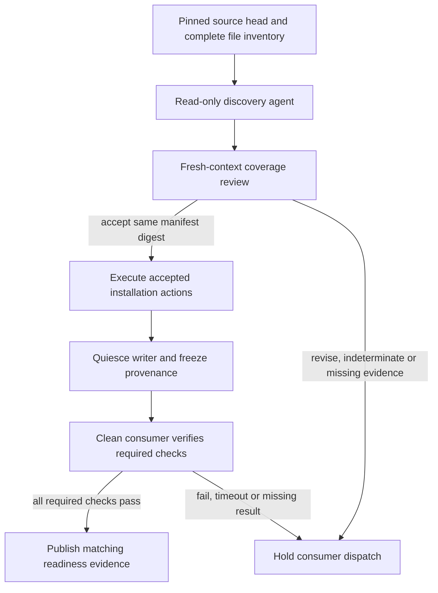

# 06: Environment Cache

The environment cache supplies each symphony's project tools and dependencies to
performers. Bootstrap writes the cache; consumers mount it read-only. Project setup
comes from repository evidence and an independently reviewed environment manifest.
Coordinare does not choose a project's runtime, framework or service from a built-in
catalog.

For configuration, limits and recovery, read the
[reviewed environment operator guide](../operators/reviewed-environment-manifest.md).

## Bootstrap and readiness



1. The daemon pins discovery reads to the source commit and obtains a complete
   repository file inventory. Source-head changes invalidate discovery, including
   additions or deletions outside previously read files. An unchanged source head
   reuses applicable accepted state without another discovery or review call.
2. A discovery agent reads arbitrary repository paths, including documentation,
   automation and nested projects. It produces explicit requirements, installation
   commands, activation declarations, service lifecycle commands and checks. Each
   required requirement maps to required executable checks.
3. An independent reviewer starts a separate conversation with the candidate and
   the same snapshot. It independently reads the cited inputs and may inspect more
   files. Only an `accept` assessment bound to the candidate's digest and commit
   permits installation. Missing configuration, malformed output, exhausted limits
   and nonaccept verdicts hold the environment.
4. The performer installs the accepted contract. Its success message cannot make
   the cache ready. Contract edits require a new independent assessment.
5. After the writer stops, the configured Docker or Kubernetes verifier runs the
   accepted checks in a clean consumer context with a read-only cache, supplied
   source and writable scratch state. Required failures, timeouts, missing results
   and failed prerequisites hold dispatch. Optional results remain visible.
6. The daemon publishes readiness only with matching acceptance, successful
   verification and frozen cache provenance. Trusted manifest, activation and
   verification data remain outside installer authority.

The existing conducting brain's `openai_api` JSON-chat configuration supplies both
agent phases. Review uses fresh conversation state; it does not require a separate
model role or vendor. Other conducting backends do not currently provide this
JSON-chat seam. See the operator guide before enabling environment caching.

## Cache and consumer lifecycle

The host cache lives under `~/.coordinare/env-caches/<symphony-slug>/`; its container
mount is `/devenv/<slug>`. Bootstrap receives a writable mount and consumers receive
a read-only mount. Installed paths are project declarations, not prescribed
runtime-manager directories.

Activation applies the accepted PATH entries and environment updates using the
explicit `{cache}`, `{repo}` and `{scratch}` roots. `${NAME}` references resolve at
runtime. Activation is repeatable and does not implicitly start services or search
for tools. Generic platform facilities such as native archive extraction remain
separate from project selection.

Services declare their initialization, start, health and stop commands. They use
writable consumer-local scratch state rather than writing runtime state into the
read-only cache. Required health gates verification; cleanup runs at the explicit
lifecycle boundary. The bootstrap container's running processes are not reused by
consumers. Legacy inferred service kinds and built-in recipes do not establish
readiness under the reviewed contract.

## Attempts, pauses and recovery

Existing bootstrap deadlines, attempt limits and manual-trigger cooldowns still
apply. Review cannot waive them or waive a required check. An exhausted attempt
holds consumer dispatch with a reason; it must not restart discovery every poll.
The dashboard's **Force bootstrap now**, or
`POST /api/symphonies/{name}/env-bootstrap`, resets the bootstrap budget subject to
the existing one-reset-per-15-minutes limit. A cooldown refusal returns 429.

A symphony with `enabled: false` is paused. No new bootstrap, retry or restart
reverification starts while paused; a running bootstrap can finish or be reaped.
A manual trigger while paused returns 409. Resume the symphony before retrying.

Idle bootstrap reaping defaults to 1800 seconds; an unmatched tool call has a
separate 2700-second bound. The outer bootstrap wall clock defaults to 3600 seconds.
These existing job limits also constrain bounded workflows. Discovery and review
have their own shorter phase budgets, described in the operator guide.

State schema 40 persists the reviewed manifest and assessment. Older snapshots
load without an accepted pair and require reconstruction before consumer dispatch.
Existing cache bytes are retained while replacement evidence is obtained; old
success flags or scripts do not count as acceptance. Upgrade daemon, performer and
trusted verifier images together.

## Optional bounded bootstrap workflow

Select the workflow using an existing backend and mode:

```yaml
performers:
  env_bootstrap:
    backend: codex
    mode: bootstrap-mode
    workflow: env_bootstrap
    workflow_env:
      ENV_BOOTSTRAP_MAX_REPAIRS: "1"
      ENV_BOOTSTRAP_TIMEOUT_SECONDS: "1800"
```

Repairs may fix installed content and rerun the accepted checks. They cannot change
requirements, commands, activation or requiredness. The repair budget defaults to
one and accepts zero through two. The workflow timeout defaults to 1800 seconds
and accepts 1 through 3600, further bounded by the daemon's positive outer deadline.
The prose bootstrap path must satisfy the same accepted-contract gate.

## Docker and Kubernetes trust

Both transports retain writer-quiescence checks, safe cache writes, frozen
provenance, trusted result collection and clean verification. Installer-writable
scripts and process output cannot authorize readiness. Trusted runtime code
records actual command exit status for the accepted digest.

Kubernetes selects the verifier through `kubernetes_verifier_image`, defaulting to
`performer_image`; symphony endpoint images cannot select it. In Helm, configure
`config.kubernetes_verifier_image` and `performers.imagePullSecrets` as needed.
Use an immutable image digest when pinning registry content.

The verifier pod uses UID/GID 10001, a read-only root filesystem, no privilege
escalation, dropped capabilities and `seccompProfile: RuntimeDefault`. `/tmp` is a
writable `emptyDir`; service-account token automount and service links are disabled.
Cache files must be readable and binaries executable by the verifier identity.
The serialized verifier pod remains bounded at 768 KiB, including supplied inputs.
Configure required network controls at the deployment boundary; these documents do
not claim that live Docker or Kubernetes deployments have been validated.

## State and implementation

| Concern | Location |
|---|---|
| Per-symphony readiness state | `EnvCacheState` and `coordinare.state.json` |
| Bootstrap orchestration | `src/coordinare/services/env_cache.py` |
| Snapshot discovery and independent review | `src/coordinare/services/environment_discovery.py` |
| Shared schema, runner and trusted rendering | `packages/service_inference/src/coordinare_service_inference/environment/` |
| Limits and cache configuration | `EnvCacheConfig` in `src/coordinare/config.py` |

Next: **[07: Roadmap](07-roadmap.md)**.
