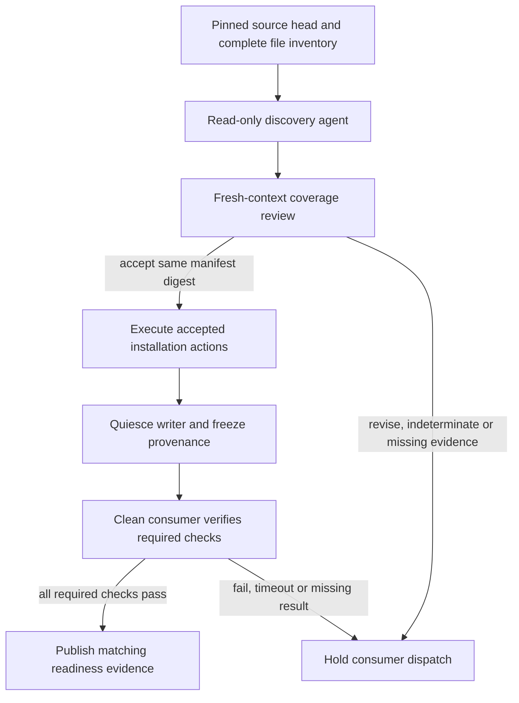

# 06: Environment Cache

The environment cache supplies each symphony's project tools and dependencies to
performers. Bootstrap writes the cache; consumers mount it read-only. Project setup
comes from repository evidence and an independently reviewed environment manifest.
Coordinare does not choose a project's runtime, framework or service from a built-in
catalog.

For configuration, limits and recovery, read the
[reviewed environment operator guide](../operators/reviewed-environment-manifest.md).

## Bootstrap and readiness



1. The daemon pins discovery reads to the source commit and obtains a complete
   repository file inventory. Source-head changes invalidate discovery, including
   additions or deletions outside previously read files. An unchanged source head
   reuses applicable accepted state without another discovery or review call.
2. A discovery agent reads arbitrary repository paths, including documentation,
   automation and nested projects. It produces explicit requirements, installation
   commands, activation declarations, service lifecycle commands and checks. Each
   required requirement maps to required executable checks.
3. An independent reviewer starts a separate conversation with the candidate and
   the same snapshot. It independently reads the cited inputs and may inspect more
   files. Only an `accept` assessment bound to the candidate's digest and commit
   permits installation. Missing configuration, malformed output, exhausted limits
   and nonaccept verdicts hold the environment.
4. The performer installs the accepted contract. Its success message cannot make
   the cache ready. Contract edits require a new independent assessment.
5. After the writer stops, the configured Docker or Kubernetes verifier runs the
   accepted checks in a clean consumer context with a read-only cache, supplied
   source and writable scratch state. Required failures, timeouts, missing results
   and failed prerequisites hold dispatch. Optional results remain visible.
6. The daemon publishes readiness only with matching acceptance, successful
   verification and frozen cache provenance. Trusted manifest, activation and
   verification data remain outside installer authority.

The existing conducting brain's `openai_api` JSON-chat configuration supplies both
agent phases. Review uses fresh conversation state; it does not require a separate
model role or vendor. Other conducting backends do not currently provide this
JSON-chat seam. See the operator guide before enabling environment caching.

## Cache and consumer lifecycle

The host cache lives under `~/.coordinare/env-caches/<symphony-slug>/`; its container
mount is `/devenv/<slug>`. Bootstrap receives a writable mount and consumers receive
a read-only mount. Installed paths are project declarations, not prescribed
runtime-manager directories.

Activation applies the accepted PATH entries and environment updates using the
explicit `{cache}`, `{repo}` and `{scratch}` roots. `${NAME}` references resolve at
runtime. Activation is repeatable and does not implicitly start services or search
for tools. Generic platform facilities such as native archive extraction remain
separate from project selection.

Services declare their initialization, start, health and stop commands. They use
writable consumer-local scratch state rather than writing runtime state into the
read-only cache. Required health gates verification; cleanup runs at the explicit
lifecycle boundary. The bootstrap container's running processes are not reused by
consumers. Legacy inferred service kinds and built-in recipes do not establish
readiness under the reviewed contract.

## Attempts, pauses and recovery

Existing bootstrap deadlines, attempt limits and manual-trigger cooldowns still
apply. Review cannot waive them or waive a required check. An exhausted attempt
holds consumer dispatch with a reason; it must not restart discovery every poll.
The dashboard's **Force bootstrap now**, or
`POST /api/symphonies/{name}/env-bootstrap`, resets the bootstrap budget subject to
the existing one-reset-per-15-minutes limit. A cooldown refusal returns 429.

A symphony with `enabled: false` is paused. No new bootstrap, retry or restart
reverification starts while paused; a running bootstrap can finish or be reaped.
A manual trigger while paused returns 409. Resume the symphony before retrying.

Idle bootstrap reaping defaults to 1800 seconds; an unmatched tool call has a
separate 2700-second bound. The outer bootstrap wall clock defaults to 3600 seconds.
These existing job limits also constrain bounded workflows. Discovery and review
have a shared 600-second attempt budget plus 120-second phase budgets, at most
two repair rounds, 128 total model calls and 512 total reads by default. Directory
pages and batched reads bound model context. See the operator guide for configuration.

State schema 40 persists the reviewed manifest and assessment. Older snapshots
load without usable capability/inventory bindings and require reconstruction before
consumer dispatch. A completion success flag cannot waive missing/failed clean
execution or frozen provenance, and verified installations may use any layout.
Existing cache bytes are retained while replacement evidence is obtained; old
success flags or scripts do not count as acceptance. Upgrade daemon, performer and
trusted verifier images together. Before retrying, pin the clean verifier image by
SHA256 digest and configure the transport network isolation described below.

## Optional bounded bootstrap workflow

Select the workflow using an existing backend and mode:

```yaml
performers:
  env_bootstrap:
    backend: codex
    mode: bootstrap-mode
    workflow: env_bootstrap
    workflow_env:
      ENV_BOOTSTRAP_MAX_REPAIRS: "1"
      ENV_BOOTSTRAP_TIMEOUT_SECONDS: "1800"
```

Repairs may fix installed content and rerun the accepted checks. They cannot change
requirements, commands, activation or requiredness. The repair budget defaults to
one and accepts zero through two. The workflow timeout defaults to 1800 seconds
and accepts 1 through 3600, further bounded by the daemon's positive outer deadline.
The prose bootstrap path must satisfy the same accepted-contract gate.

## Docker and Kubernetes trust

Both transports retain writer-quiescence checks, safe cache writes, frozen
provenance, trusted result collection and clean verification. Installer-writable
scripts and process output cannot authorize readiness. Trusted runtime code
records actual command exit status for the accepted digest.

Clean verification requires an immutable `image@sha256:<64 lowercase hex digits>`
reference on both transports; a mutable tag holds readiness. Docker uses the
selected bootstrap performer's image and runs the clean verifier with
`--network none`. Pin the image actually configured for that performer/endpoint.

Kubernetes selects the verifier through `kubernetes_verifier_image`, defaulting to
`performer_image`; symphony endpoint images cannot select it. In Helm, configure
`config.kubernetes_verifier_image` and `performers.imagePullSecrets` as needed.
Set an immutable digest even when a registry tag already exists.
When Kubernetes environment caching is configured, consumer endpoint images must
equal `kubernetes_verifier_image`; configuration loading rejects a mismatch.
Only an endpoint whose roles are exclusively `env_bootstrap` may use another image.

Kubernetes also requires externally enforced verifier egress isolation. Configure
a NetworkPolicy for pods labeled `coordinare.role: env-verifier`, ensure the
cluster's CNI enforces it, and validate the policy before setting
`env_cache.kubernetes_verifier_network_isolated: true`. This flag defaults to
`false` and attests to deployment policy; setting it does not create or enforce a
policy. Missing attestation holds clean verification. Network isolation and image
pinning cannot substitute for coverage review or required checks.

The verifier pod uses UID/GID 10001, a read-only root filesystem, no privilege
escalation, dropped capabilities and `seccompProfile: RuntimeDefault`. `/tmp` is a
writable `emptyDir`; service-account token automount and service links are disabled.
Cache files must be readable and binaries executable by the verifier identity.
The serialized verifier pod remains bounded at 768 KiB, including supplied inputs.
Validate the externally enforced Kubernetes network controls at the deployment
boundary. These documents do not claim that live Docker or Kubernetes deployments
have been validated.

## State and implementation

| Concern | Location |
|---|---|
| Per-symphony readiness state | `EnvCacheState` and `coordinare.state.json` |
| Bootstrap orchestration | `src/coordinare/services/env_cache.py` |
| Snapshot discovery and independent review | `src/coordinare/services/environment_discovery.py` |
| Shared schema, runner and trusted rendering | `packages/service_inference/src/coordinare_service_inference/environment/` |
| Limits and cache configuration | `EnvCacheConfig` in `src/coordinare/config.py` |

Next: **[07: Roadmap](07-roadmap.md)**.


Reviewed environment discovery delivers every manifest input to a fresh independent
reviewer before requesting coverage judgment. Schema corrections, coverage revisions
and executable repairs each have separate durable limits (default two), under one
unchanged aggregate deadline. Missing or oversized evidence holds; successful clean
execution of every required check remains mandatory. See the
[operator guide](../operators/reviewed-environment-manifest.md#complete-reviewer-evidence-and-correction-limits)
for configuration and legacy-attempt migration.

### Capability probes and installation assertions

Discovery can request bounded, repository-cited capability probes in the pinned
consumer image before constructing a manifest. Probes have no network, runtime
secrets, host sockets, writable source or writable cache. Each logical attempt
permits two batches of at most 16 commands, with 30 seconds per command and 120
seconds per batch, subject to its original remaining deadline. Output is bounded
at 16 KiB per command; incomplete or truncated observations hold. An absent tool
is evidence for installation planning, not a passing required check.

The Docker adapter supplies this isolation. Other adapters hold when they cannot
establish the same restrictions; a Kubernetes deployment never falls back to the
local Docker daemon. Pending older attempt journals require an explicit operator
restart after confirmed cleanup. Existing accepted frozen contracts remain readable.

Repair automatically receives every previous input with independently verified
hashes. Independent coverage review still fetches its own evidence. Required
installation assertions use ordinary install commands and dependency edges to
establish outputs before dependent actions. Every required clean-consumer check
and service action remains mandatory, regardless of probes or reviewer approval.

The private validation harness requires separate scope approval for each exact
probe plan and accepted manifest digest. Timeout defaults remain unchanged;
longer validation profiles are explicit experiments and never renew a live attempt.

Production bootstrap requires completed capability preflight before it can accept
a manifest. A premature manifest gets one stage reminder; repeatedly skipping
preflight holds without renewing any budget. A repaired attempt may reuse prior
complete base-image observations only while source/image/platform identities match.


### Complete source for execution

Model review inputs are bounded evidence, not a checkout. Bootstrap probes and
clean verification use a separate complete repository tree at the accepted
immutable commit. The provider verifies binary contents, Git blob identities and
file modes; the shared restorer preserves executable files and safe relative
symlinks. The installer checks its actual initial checkout against the same source
identity. Clean verification restores fresh pinned source and uses the cache read
only, with networking disabled. Installer source mutations do not become clean
consumer inputs.

Execution source is bounded separately: 128 MiB compressed transport, 512 MiB
expanded contents including metadata, 64 MiB per blob, 100,000 entries, 256 missing
blob completions and eight concurrent provider reads. Chunks remain 64 KiB and
Kubernetes objects remain below their existing byte ceiling. Source acquisition
uses existing deadlines, with no additional model calls or renewed repair quota.
The daemon reads repository APIs and never clones or executes project commands.

Missing/corrupt source and unsupported submodule/LFS hydration hold readiness;
review-only files cannot substitute for a complete checkout. Source identity is
recorded alongside manifest, image and platform identity. Journal version 4 keeps
source ownership and prior consumption: interrupted source work requires confirmed
cleanup. Pending older journals require explicit restart after cleanup, and older
cache evidence needs normal rebuild/reverification. No old passing flag is promoted
into source-complete evidence. Activation must make installed tools usable through
normal project command names, not only absolute paths in version checks.

### Persistent coverage findings

Coverage objections stay in an attempt-owned ledger across revisions and restarts.
Discovery responds to each open finding; every fresh reviewer independently decides
every retained finding against the current manifest and pinned source evidence.
An overall acceptance cannot silently drop an objection. A cited false-positive
resolution is permitted, but required checks, scope and service obligations cannot
be weakened. Required capabilities unavailable in the configured consumer hold
bootstrap explicitly; no infrastructure permissions or verification network access
are added automatically.

The ledger allows 32 findings, 2 KiB of UTF-8 per finding issue/decision rationale,
and 128 KiB including history. Existing context, call/read, deadline and category
repair limits still apply. Operator summaries show counts, finding IDs and
categories; detailed source-bound findings remain private evidence.

The journal also retains the latest validated candidate, so a restart cannot
remove established required IDs, scopes or service lifecycle obligations. Revision
charges and exhausted/held state are saved with their review transition.

New readiness requires coverage assessment version 2 and attempt journal version 5.
Older review records remain readable as historical evidence but do not establish
current readiness. Pending legacy attempts need an explicit operator restart after
confirmed cleanup; this archives prior evidence without deleting unrelated caches.
An old accepted cache must obtain current independent review and valid matching
execution evidence before reuse. Failed, unknown or unrun checks never become
successful through migration or review. The manifest schema and canonical digest
are unchanged.
